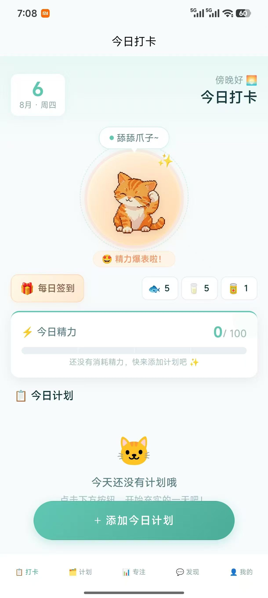
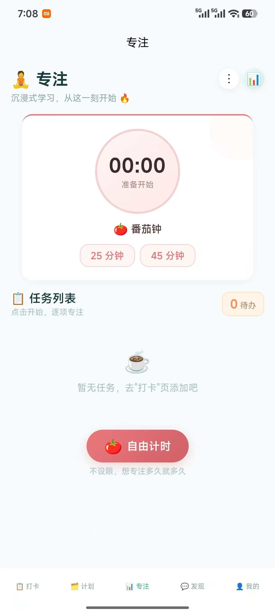
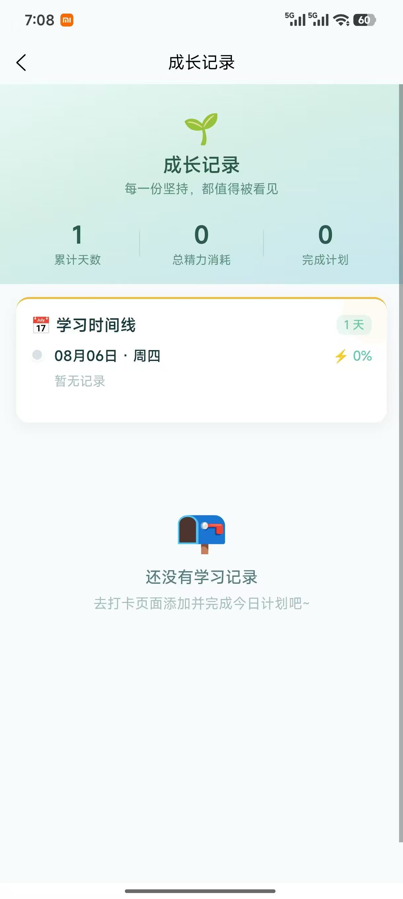
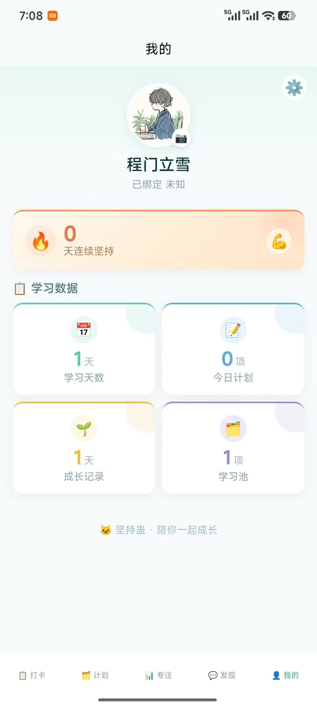

# 伴学喵

一个把「学习计划 → 番茄钟 → 打卡 → 养成 → 社区」串成闭环的学习陪伴 App。
uni-app（Vue 3）+ uniCloud 阿里云，一套代码可以打包 App / H5 / 小程序。

> 这是我在 2025 年独立完成的移动端项目：7 个页面、约 6,900 行 Vue/JS（不含第三方 uni_modules），
> 3 个云函数、5 张云数据库表。代码按 HBuilderX 工程结构组织，APK 产物在 `unpackage/release/apk/`（未入库）。

## 界面

<table>
  <tr>
    <td align="center"><br>今日打卡 · 猫咪养成</td>
    <td align="center"><br>专注 · 番茄钟</td>
    <td align="center"><br>成长记录</td>
    <td align="center"><br>我的 · 学习数据</td>
  </tr>
</table>

## 功能

| 模块 | 页面 | 做了什么 |
| --- | --- | --- |
| 今日打卡 | `pages/today` | 每日计划、勾选完成、精力条、连续打卡天数、猫咪互动与投喂 |
| 学习池 | `pages/pool` | 预置 + 自定义学习板块，从池子里挑计划放进「今天」 |
| 专注 | `pages/analysis` | 番茄钟与自由计时，按任务累计专注时长，环形图 / 统计面板 |
| 发现 | `pages/community` | 学习社区：发帖、点赞、评论、删帖，带登录鉴权 |
| 我的 | `pages/profile` | 用户资料、成长记录入口、登录注册、云端备份与恢复 |
| 成长记录 | `pages/growth` | 历史打卡、连续天数、数据统计 |
| 设置 | `pages/settings` | 备份信息、同步状态、账号操作 |

猫咪状态组件 `components/CatPet/CatPet.vue` 会根据精力、互动和时间切换 12 套 GIF 动画
（`static/cat/`），投喂鱼干 / 牛奶 / 罐头会影响状态 —— 这是让「学习打卡」不只是一张待办清单的那部分。

## 技术结构

```
坚持蛊/
├── pages/                     # 7 个页面（5 个 tab + 成长记录 + 设置）
├── components/CatPet/         # 猫咪状态组件
├── utils/
│   ├── storage.js             # 本地数据层：读写、跨天归档、打卡/投喂
│   ├── sync.js                # 云端备份：全量上传 / 下载 / 5 秒防抖自动备份
│   ├── auth.js                # 登录注册、token 本地保存、失效时回退本地账号
│   └── community.js           # 社区接口封装
├── uniCloud-aliyun/
│   ├── cloudfunctions/
│   │   ├── auth-api/          # 注册、登录、checkToken、改资料
│   │   ├── community-api/     # 帖子、点赞、评论
│   │   └── data-api/          # 学习数据上传 / 下载 / 同步时间
│   └── database/              # users / user_data / posts / likes / comments
├── static/                    # 猫咪 GIF、图标
└── manifest.json / pages.json # 应用与路由配置
```

### 两个当时特意做的设计

1. **离线优先。** 所有学习数据先写 `uni.getStorageSync('study_elf_app_data')`，断网、未登录都能完整使用；
   登录后 `storage.js` 每次写入都会触发 `sync.js` 的全量备份，5 秒防抖，避免高频写云数据库。
2. **跨天归档。** `normalizeData()` 在读取时判断 `lastDateKey`，把昨天已完成但没入库的计划补进
   `history`，然后清空今日列表、重置 7 天 / 30 天奖励标记。避免「跨零点打开 App 数据错乱」。

## 跑起来

1. 用 HBuilderX 打开本目录。
2. `uniCloud-aliyun` 右键 → **关联云服务空间**（需要自己的 DCloud 账号和阿里云空间）。
3. 右键 `uniCloud-aliyun/database` → **上传所有 DB Schema**。
4. 右键每个 `cloudfunctions/*` → **上传部署**。
5. 运行到浏览器 / 手机模拟器 / 真机。

> 云端部分需要自己的 uniCloud 空间；不关联也能跑，只是登录和社区不可用（本地打卡、计划、番茄钟不受影响）。

## 已知问题（诚实清单）

- 密码使用「固定盐 + SHA-256」，没有逐用户随机盐，也不够抗暴力破解；正式上线应换成 bcrypt/argon2。
- `utils/sync.js` 注释写的是「加密备份」，实际是 `JSON.stringify` 后明文存云数据库 —— 注释与实现不符，应改成明文描述或补上加密。
- 没有自动化测试；验证方式是真机跑通和手动回归。
- 社区内容没有敏感词过滤和举报入口。
